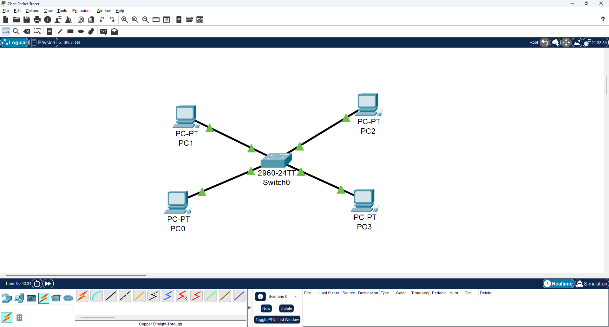

# Project: VLAN and Trunking Lab

## Objective

Design and implement a network segmented with VLANs to separate administration, guest and IoT traffic.

Connect two switches with a trunk link that carries the VLANs between them.

---

## Devices and addressing

| Device | Interface | IP address       | VLAN |
|--------|-----------|------------------|------|
| PC0    | Fa0       | 192.168.10.1     | 10   |
| PC1    | Fa0       | 192.168.10.2     | 10   |
| PC2    | Fa0       | 192.168.20.1     | 20   |
| PC3    | Fa0       | 192.168.30.1     | 30   |
| PC4    | Fa0       | 192.168.10.3     | 10   |
| PC5    | Fa0       | 192.168.20.2     | 20   |

## Switch0 interface configuration

| Interface | Mode   | Assigned VLAN |
|-----------|--------|---------------|
| Fa0/1     | Access | 10            |
| Fa0/2     | Access | 10            |
| Fa0/3     | Access | 20            |
| Fa0/4     | Access | 30            |
| Fa0/24    | Trunk  |               |

## Switch1 interface configuration

| Interface | Mode   | Assigned VLAN |
|-----------|--------|---------------|
| Fa0/1     | Access | 10            |
| Fa0/2     | Access | 20            |
| Fa0/24    | Trunk  |               |

## Network design

The network is split into three independent VLANs, each with its own IP range:

- VLAN 10 → 192.168.10.0/24
- VLAN 20 → 192.168.20.0/24
- VLAN 30 → 192.168.30.0/24

## Topology



---

## VLAN roles

- VLAN 10 → Administration
- VLAN 20 → Guests
- VLAN 30 → IoT

- Layer 2 switches with:
  - Access ports for hosts
  - A trunk port between the switches

---

## Configuration

### Creating the VLANs

```bash
vlan 10
 name ADMIN

vlan 20
 name GUEST

vlan 30
 name IOT
```

### Access ports

```bash
interface fa0/1
 switchport mode access
 switchport access vlan 10

interface fa0/2
 switchport mode access
 switchport access vlan 10

interface fa0/3
 switchport mode access
 switchport access vlan 20

interface fa0/4
 switchport mode access
 switchport access vlan 30
```

### Trunk port

```bash
interface fa0/24
 switchport mode trunk
```

## Tests

### Ping within the same VLAN

PC0 → PC1 → OK

### Ping between VLANs

PC0 → PC2 → FAIL
PC0 → PC3 → FAIL

### Ping across the trunk

PC0 → PC4 (same VLAN, other switch) → OK
PC0 → PC5 (different VLAN, other switch) → FAIL

## Verification

### VLANs

```bash
show vlan brief
```

## How the trunk works

The trunk link carries several VLANs using 802.1Q tagging. Each frame includes a VLAN identifier, which lets the switches keep the network segmented across the link.

### Results

- Devices in the same VLAN can reach each other
- Devices in different VLANs cannot communicate
- Segmentation works as designed
- The trunk works as designed

## Conclusion

VLAN segmentation was implemented on Layer 2 switches, confirming isolation between networks and connectivity within each one.

## Lab file

The Packet Tracer file used in this project is available at:

`labs/vlan-lab.pkt`

It reproduces the topology and configurations described above.
